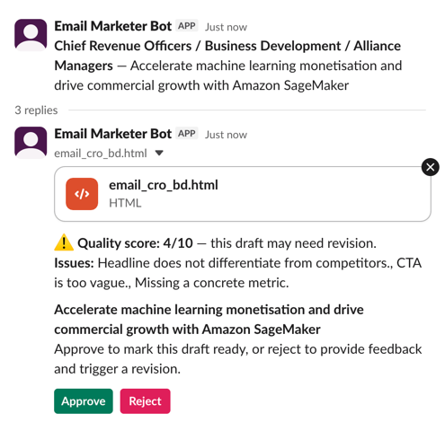

# SlackMarketingEmailDemo

A Python agent that receives Slack slash commands or events and generates marketing email content using an AI agent.

## Configuration

The agent service expects a `.env` file with:

```
SLACK_BOT_TOKEN=xoxb-...
SLACK_SIGNING_SECRET=...
ANTHROPIC_API_KEY=...
```

## Getting Started

```bash
cd services/agent
uv sync
uv run python -m agent
```

## Architecture

The agent service is a FastAPI app that:

1. Receives Slack events/commands via a webhook endpoint
2. Verifies the Slack request signature
3. Runs an AI agent to generate or refine marketing email content
4. Posts the result back to the originating Slack channel

## Services

### agent (FastAPI) — `services/agent`

Handles the Slack webhook and AI agent orchestration.

**Endpoints:**
- `GET /health` — health check
- `POST /slack/events` — Slack Events API handler
- `POST /slack/commands` — Slack slash command handler

## Slack examples

