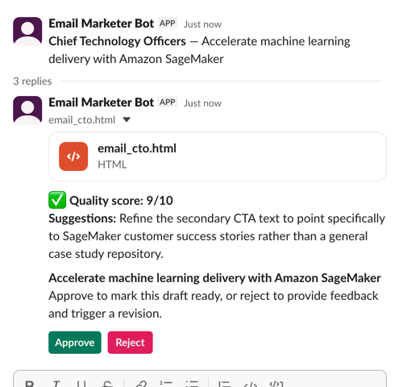
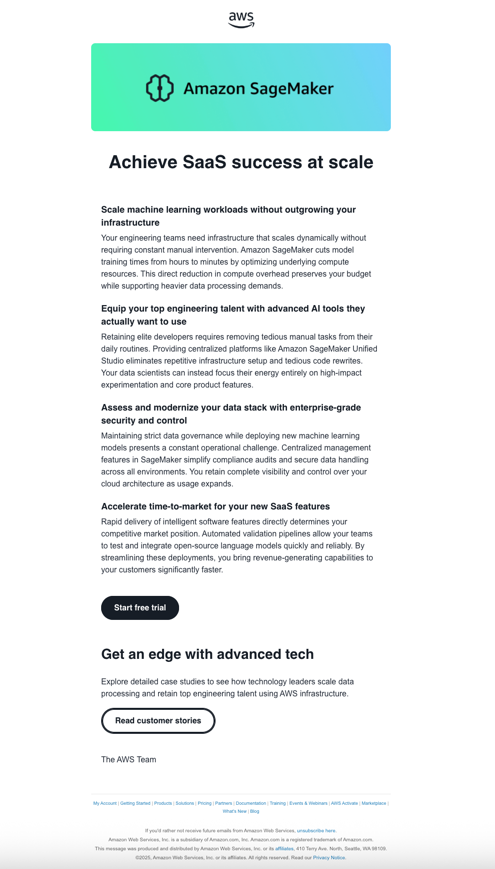
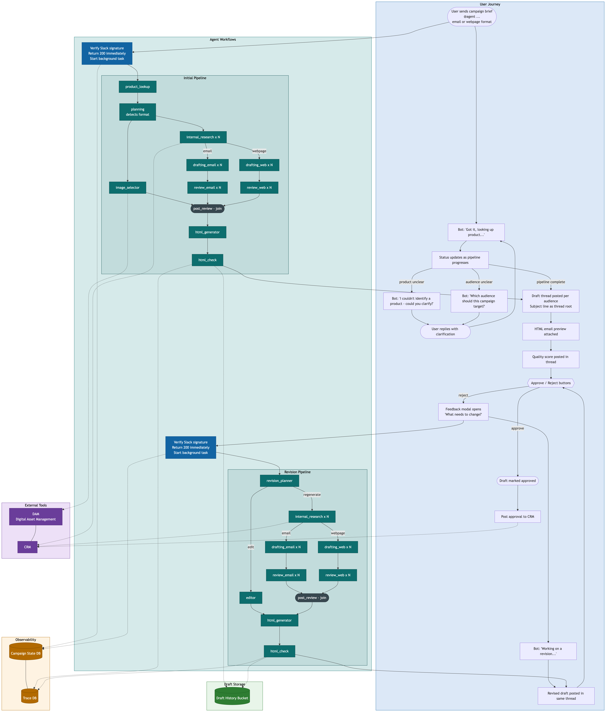

# SlackMarketingEmailDemo

A Python agent that receives Slack slash commands or events and generates marketing email content using an AI agent.

## Configuration

The agent service expects a `.env` file with:

```
SLACK_BOT_TOKEN=xoxb-...
SLACK_SIGNING_SECRET=...
GOOGLE_API_KEY=...
TAVILY_API_KEY=...
```

## Getting Started

Note - I have used ngrok to give slack access to locally running app.

```bash
cd services/agent
uv sync
uv run python -m agent
```

## Architecture

The agent service is a FastAPI app that:

1. Receives Slack events/commands via a webhook endpoint
2. Verifies the Slack request signature
3. Runs an AI agent to generate or refine marketing email content
4. Posts the result back to the originating Slack channel

### Agent pipeline

Each request runs through a multi-stage LangGraph pipeline:

1. **Product lookup** — identifies the AWS product from the brief
2. **Planning** — matches the brief to one or more audience segments (e.g. CTO, CPO, VP Engineering) and produces a campaign plan
3. **Research** — gathers insights and talking points per audience (runs in parallel)
4. **Drafting** — writes subject line, headline, body sections, and CTAs tailored to each audience
5. **Review** — scores the draft against brand and quality criteria; replaces any banned words
6. **HTML generation** — renders each draft to a standalone HTML email file (`services/agent/generated_emails/`)

### Approval and revision workflow

Each generated draft is posted to Slack with Approve / Reject buttons. Rejecting opens a feedback modal; the agent uses that feedback to revise the draft and re-posts it in the same thread.

## Services

### agent (FastAPI) — `services/agent`

Handles the Slack webhook and AI agent orchestration.

**Endpoints:**
- `POST /slack/events` — Slack Events API handler
- `POST /slack/actions` — handles Slack interactive components (approve/reject buttons, feedback modal)

## Slack examples

1. Slack thread once a draft has been generated


2. Specific warning about the quality being poor


## Email examples

For a CTO


Reject and use feedback (from the review on slack ex 1)


## Diagram
(from diagram.md)

This covers UX, agent outline, storage, integrations

